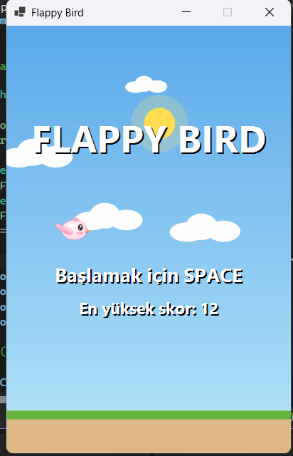
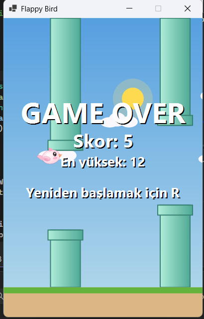

# YMH219 - Flappy Bird

Nesne Tabanlı Programlama (YMH219) dersi kapsamında Windows Forms ile geliştirilmiş Flappy Bird benzeri bir masaüstü oyunudur. Oyuncu, kuşu klavye veya fare ile zıplatarak borular arasından geçirmeye çalışır. Oyun; zamanlayıcı ile çalışan bir oyun döngüsü, çarpışma kontrolü ve nesne tabanlı bir sınıf yapısı üzerine kuruludur.

## Kullanılan Teknolojiler

- C# / .NET 10
- Windows Forms
- GDI+ (`System.Drawing`) ile çizim
- Visual Studio 2022
- Ek NuGet paketi kullanılmamıştır

## Kurulum ve Çalıştırma

1. Depoyu klonlayın:
   ```bash
   git clone https://github.com/Sumeyraadiyaman/YMH219-FlappyBird.git
   ```
2. `YMH219-FlappyBird.slnx` dosyasını Visual Studio ile açın.
3. Visual Studio'da ".NET desktop development" iş yükünün kurulu olduğundan emin olun.
4. `F5` tuşu ile oyunu çalıştırın.

## Kontroller

| Tuş | İşlev |
|---|---|
| `Space` / `↑` / Fare tıklaması | Oyunu başlat / Zıpla |
| `R` | Oyun bittikten sonra yeniden başlat |

## Özellikler

- **Yer çekimi ve zıplama:** Kuş, hız ve yer çekimi değerleriyle fiziksel olarak hareket eder.
- **Hareketli engeller:** Borular sağdan sola akar; ekrandan çıkan borular rastgele boşlukla yeniden konumlandırılır.
- **Çarpışma kontrolü:** Boruya veya zemine çarpınca oyun durur ve "Game Over" ekranı gösterilir.
- **Skor:** Geçilen her boru için skor artar.
- **Yeniden başlatma:** `R` tuşu ile yeni oyun başlatılır.
- **Hız artışı (ek özellik):** Her 5 puanda oyun hızlanır.
- **En yüksek skor (ek özellik):** Rekor dosyaya kaydedilir, uygulama kapatılıp açılsa da korunur.
- **Gece-gündüz döngüsü (ek özellik):** Güneş batar, ay doğar, yıldızlar belirir ve döngü sürekli devam eder.
- **Animasyonlar:** Kuş kanat çırpar, hızına göre eğilir ve başlangıç ekranında süzülür. Arka planda bulutlar akar.

## Sınıf Yapısı

| Sınıf | Sorumluluğu |
|---|---|
| `Bird` | Kuşun konumu, fiziği (yer çekimi, zıplama), animasyonu ve çizimi |
| `Pipe` | Bir boru çifti; hareket, yeniden konumlanma ve çarpışma kontrolü |
| `Game` | Oyun kuralları ve durumu (`Ready`, `Playing`, `GameOver`), skor, hız, rekor kaydı |
| `Sky` | Gece-gündüz döngüsü, güneş, ay ve yıldızlar |
| `Cloud` | Arka planda akan tek bir bulut |
| `Form1` | Oyun döngüsü (`Timer`), klavye/fare olayları ve çizimin tetiklenmesi |

Her sınıfın tek bir sorumluluğu vardır. `Form1` yalnızca olayları dinler ve oyunu ilerletir; oyun kuralları `Game` sınıfında, nesnelerin davranışı ise kendi sınıflarındadır.

## Ekran Görüntüleri

**Başlangıç ekranı**



**Oyun**



## Bilinen Sınırlamalar / Geliştirme Notları

- Rekor dosyası (`highscore.txt`) uygulamanın çalıştığı klasörde tutulur; proje temizlenip yeniden derlenirse sıfırlanabilir.
- Oyun hızı Windows zamanlayıcısına bağlıdır; farklı bilgisayarlarda akıcılık az da olsa değişebilir.
- Geliştirme fikirleri: ses efektleri, zorluk seviyesi seçimi.

## Öğrenci

- **Ad Soyad:** Sümeyra Adıyaman
- **Öğrenci No:** 250541012
